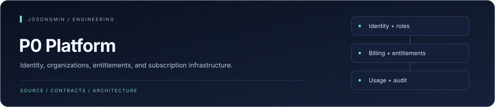
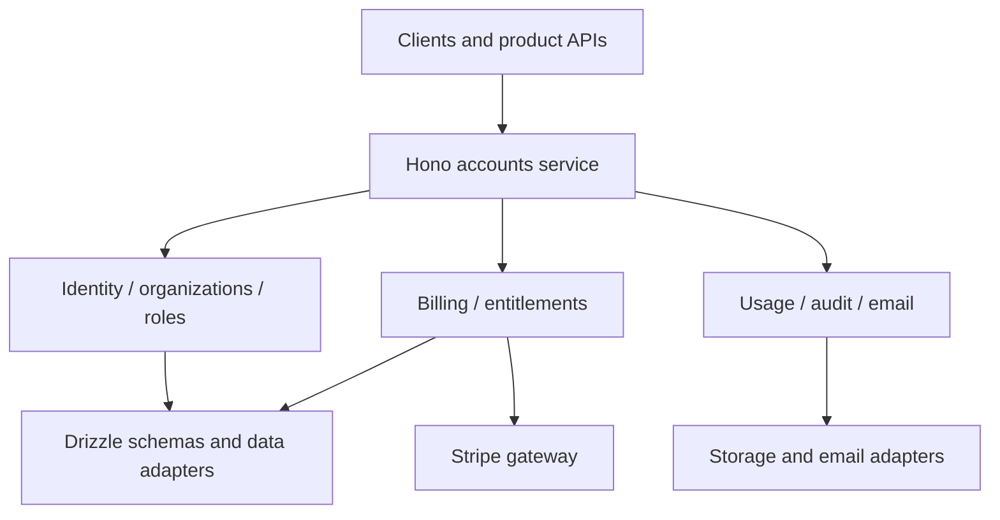

<p align="center"></p>

# P0 Platform

A Bun and TypeScript backend monorepo for authentication, organizations, subscriptions, entitlements, and usage metering. It starts with shared account operations and separates product backends through explicit contracts and feature boundaries.


## Engineering highlights

| Mechanism | Engineering purpose |
| :--- | :--- |
| **Identity and organization policy** | Better Auth integration, organization/team membership, role definitions, and guards establish the account boundary. |
| **Billing behind a gateway** | Checkout, customer-portal, and webhook behavior are separated from subscription/price policy through adapters. |
| **Entitlement projection** | Plan and role information is projected into application-facing claims rather than scattered across product handlers. |
| **Usage and audit separation** | Usage ingestion has an idempotent recording path; append-only audit records are read through their own service boundary. |
| **Shared contracts and schemas** | Contract, database, and shared packages support the account service without merging every concern into HTTP routes. |


## Architecture at a glance



## Accounts service

| Area | Responsibility |
| --- | --- |
| Authentication | better-auth organizations, teams, 2FA, sessions, API keys, and JWT/JWKS |
| Authorization | Domain roles and request guards |
| Billing | Stripe checkout, customer portal, and webhooks |
| Entitlements | Plan/role claims projected into JWTs |
| Usage | Idempotent metering ingestion and API-key guards |
| Email | Resend adapter and development console output |
| Audit | Event subscription and organization-scoped queries |

See [ARCHITECTURE.md](ARCHITECTURE.md) for the ownership model. Provider configuration and remaining work must be checked separately for Stripe prices, email delivery, and metering relay.

## Run locally

Use Bun 1.3.14 and Docker Compose.

```sh
docker compose up -d
cp .env.example .env
bun install
bun run db:push
bun run dev
```

Configure the local database and authentication secrets first. `db:push` changes the selected database schema; use a development database.

The accounts service defaults to `http://localhost:4000`. Inspect `/health`, `/openapi.json`, and `/api/auth/jwks` for service health, the HTTP contract, and public signing keys.

## Development checks

```sh
bun run typecheck
bun run lint
bun run test
```

Use `bun run auth:generate` for authentication schema generation and `bun run ratchet` for structural checks. [package.json](package.json) owns the exact commands.

## Before connecting production providers

Verify email-domain ownership and delivery, Stripe prices and webhooks, metering relay, email-verification policy, and authentication/organization audit events. Development console output and API contracts are separate from successful real delivery or billing.
